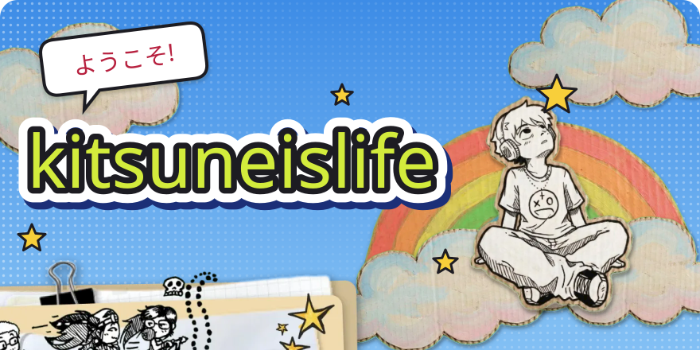<a href="https://github.com/kitsuneislife?tab=repositories"></a><a href="https://github.com/kitsuneislife/artcode">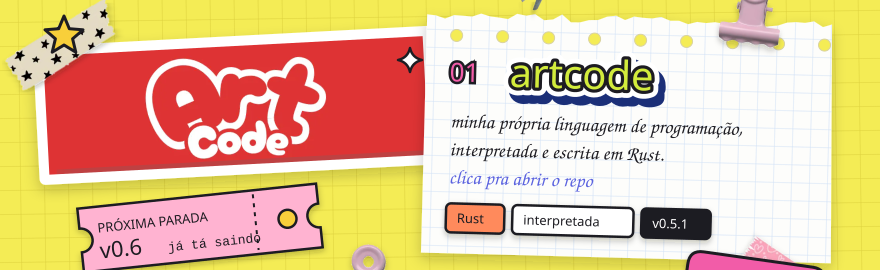</a><a href="https://kitsuneislife.github.io/lover/"></a><a href="https://github.com/kitsuneislife/clios"></a><a href="https://github.com/kitsuneislife/Acer-Nitro-V15-ANV15-51-Hackintosh">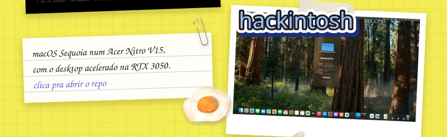</a><a href="https://github.com/kitsuneislife?tab=repositories"></a>

 
