

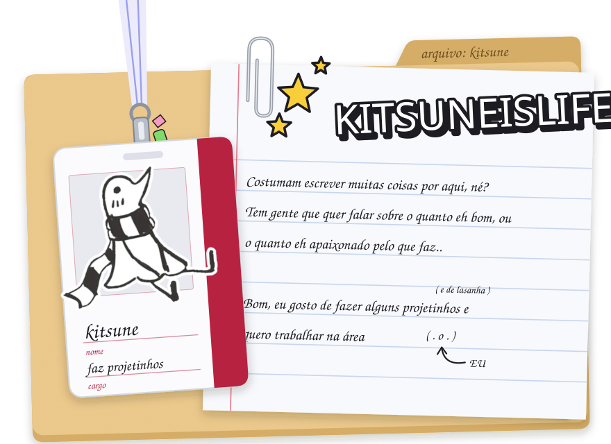

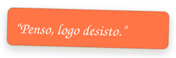

<a href="https://github.com/kitsuneislife/artcode">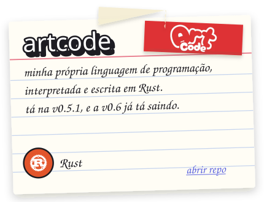</a><a href="https://kitsuneislife.github.io/lover/">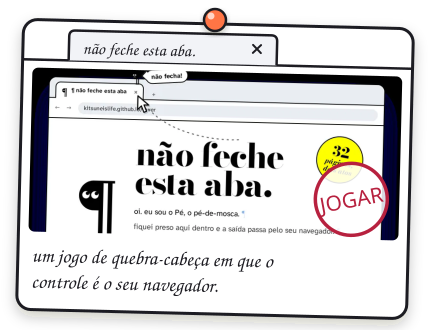</a>
<a href="https://github.com/kitsuneislife/clios"></a><a href="https://github.com/kitsuneislife/Acer-Nitro-V15-ANV15-51-Hackintosh">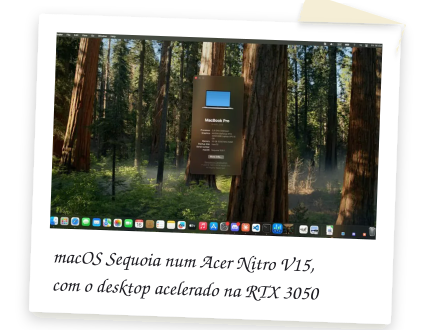</a>

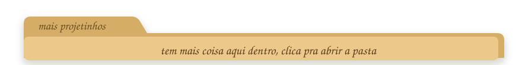

<a href="https://github.com/kitsuneislife/clipmon">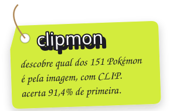</a><a href="https://github.com/kitsuneislife/artcode-merlin">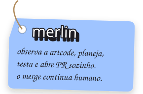</a><a href="https://github.com/kitsuneislife/nmx-intel">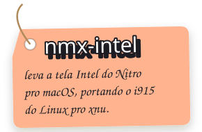</a>

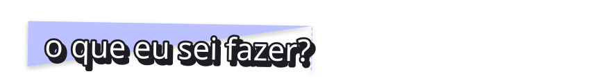

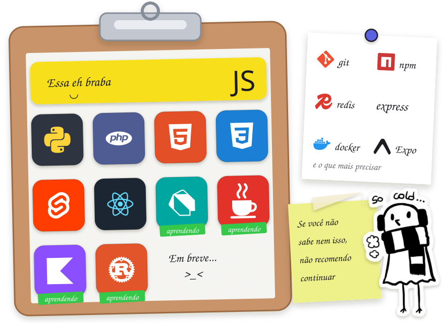_< Num bilhete do lado: git, npm, Redis, Express, Docker e Expo. Num post-it: Se você não sabe nem isso, não recomendo continuar. Um bichinho de protetor de orelha diz: so cold...">


<a href="https://kitsuneislife.github.io">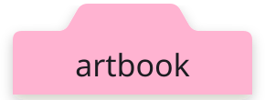</a><a href="https://kitsuneislife.github.io">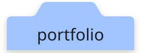</a>

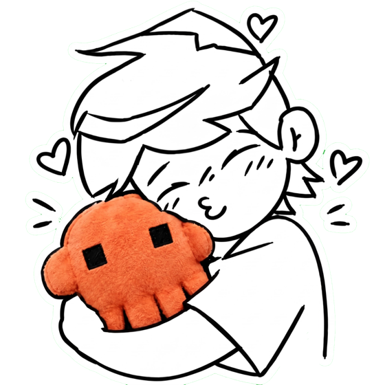
 
kitsuneislife, 2026

